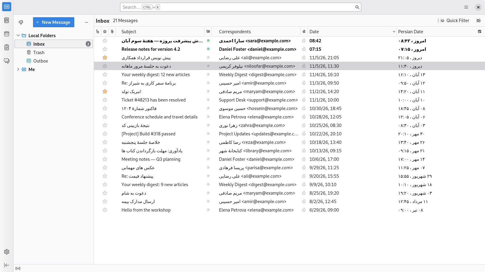
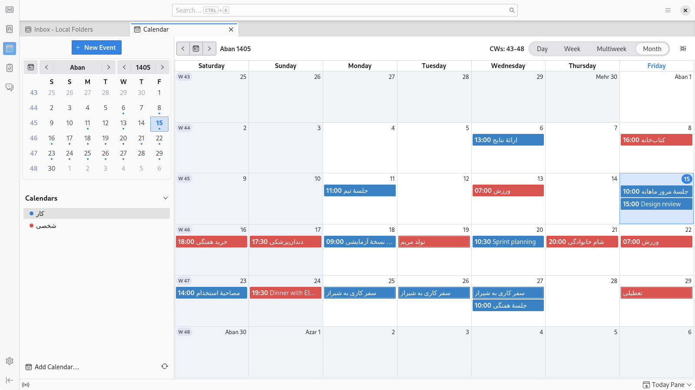
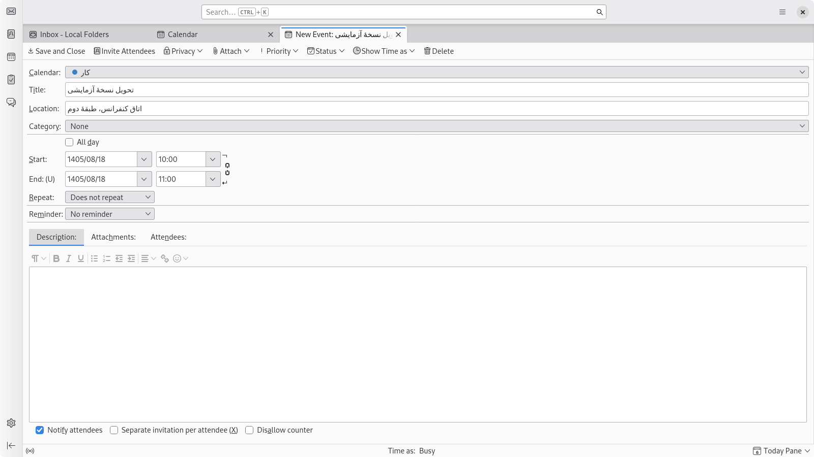
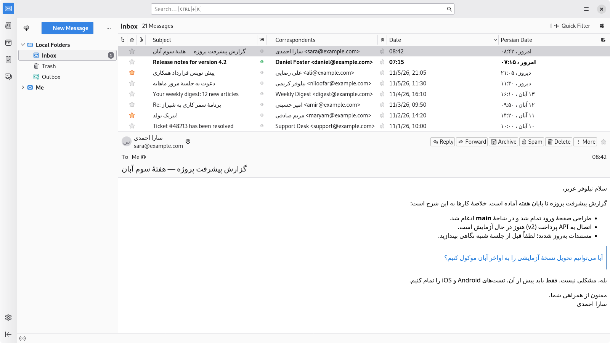
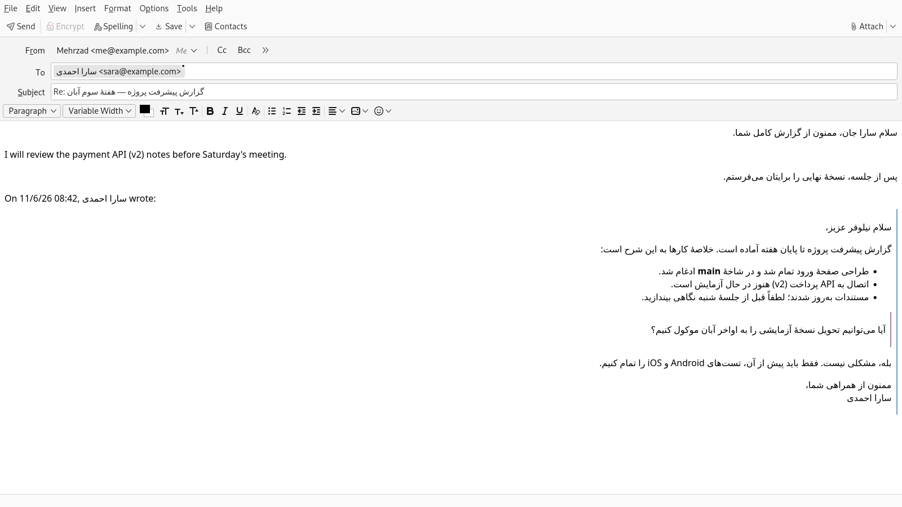
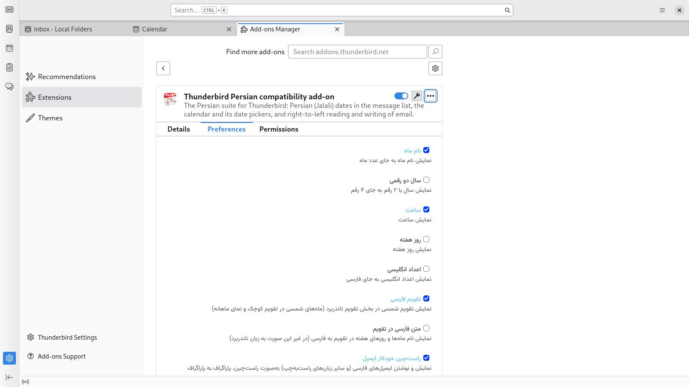

<div dir="rtl">

# سازگاری فارسی برای Thunderbird

[English](README.md)

این افزونه باعث می‌شود Thunderbird همان‌طور که یک خواننده و نویسنده فارسی‌زبان انتظار دارد کار کند:

| ویژگی | قابلیت‌های ارائه‌شده |
| --- | --- |
| **لیست پیام‌ها** | یک ستون *تاریخ شمسی* با تاریخ‌های Jalali (Shamsi) که به‌درستی مرتب می‌شود. |
| **تقویم** | ماه‌های فارسی در تب تقویم و تقویم کوچک (mini-month)، عنوان‌ها و برچسب‌های روز Jalali، اسفند کبیسه، پیمایش ماه‌های فارسی. |
| **انتخابگرهای تاریخ** | پنجره‌های رویداد و وظیفه، پیش‌نمایش تکرار و انتخابگرهای محدوده چاپ از تاریخ‌های فارسی (`1405/01/15`) استفاده می‌کنند. |
| **خواندن ایمیل** | پیام‌های فارسی (و سایر زبان‌های راست‌به‌چپ) به‌صورت راست‌چین، پاراگراف به پاراگراف، در قالب‌های HTML و متنی ساده (plain text) نمایش داده می‌شوند. |
| **نوشتن ایمیل** | پنجره نوشتن ایمیل با تایپ شما جهت هر پاراگراف را تنظیم می‌کند، بنابراین پیام ارسال‌شده در همه‌جا به‌درستی خوانده می‌شود. |

هر کدام از این قابلیت‌ها را می‌توان به‌طور جداگانه در تنظیمات افزونه فعال یا غیرفعال کرد.

## پیش‌نیازها

نسخه **159** Thunderbird (آزمایش شده روی نسخه‌های 159.0 و 160.0b5). این افزونه از APIهای آزمایشی Thunderbird استفاده می‌کند، بنابراین از طریق یک فایل XPI نصب می‌شود (در ادامه ببینید).

هنگام نصب، Thunderbird برای *خواندن و تغییر پیام‌ها هنگام نمایش* و *دسترسی به پنجره نوشتن پیام* از شما اجازه می‌خواهد: این دسترسی‌ها برای اجرای پشتیبانی از زبان‌های راست‌به‌چپ ضروری هستند.

## نصب

1. فایل XPI را از صفحه [releases](https://github.com/MehrzadGolabi/persian-compatibility-for-thunderbird/releases) دانلود کنید، یا خودتان آن را بسازید:

</div>

```sh
cd src && zip -r ../persian-compatibility-for-thunderbird.xpi .
```

<div dir="rtl">


2. در Thunderbird مسیر **Tools > Add-ons and Themes** را باز کنید، روی نماد چرخ‌دنده کلیک کرده و گزینه **Install Add-on From File...** را انتخاب کنید (برای استفاده روزمره از *Debug Add-ons > Load Temporary Add-on* استفاده نکنید: افزونه‌های موقت پس از راه‌اندازی مجدد ناپدید می‌شوند).

## نحوه استفاده

### لیست پیام‌ها

یک ستون **تاریخ شمسی** به لیست پیام‌ها اضافه می‌شود. برای پنهان کردن یا نمایش آن از انتخابگر ستون در سمت راست سربرگ استفاده کنید. پیام‌های امروز و دیروز با برچسب‌های *Today* و *Yesterday* (امروز و دیروز) مشخص می‌شوند و مرتب‌سازی این ستون بر اساس تاریخ واقعی انجام می‌شود.




### تقویم

تب تقویم را باز کنید: تقویم کوچک و نمای ماهانه، ماه‌های فارسی را همراه با عنوان‌های ماه، برچسب‌های روز و پیمایشگر فارسی نشان می‌دهند. رویدادها و وظایف مانند همیشه ذخیره شده و در روز فارسی درست ظاهر می‌شوند. برای دریافت بهترین نتیجه، در مسیر *Settings > Calendar > General*، روز **Saturday** (شنبه) را به عنوان اولین روز هفته (و جمعه را به عنوان روز تعطیل) تنظیم کنید. این افزونه تنظیمات شخصی شما را تغییر نمی‌دهد.




### انتخابگرهای تاریخ

فیلدهای تاریخ در پنجره‌های رویداد و وظیفه، پنجره‌های شرکت‌کنندگان و یادآوری، فیلد "تا" (until) در تکرار، و محدوده زمانی در پنجره چاپ تقویم (نمای لیست)، تاریخ‌های فارسی را به شکل `yyyy/mm/dd` نشان می‌دهند. می‌توانید اعداد را به فارسی یا لاتین تایپ کنید، فرمت `d/m/yyyy` نیز کار می‌کند، و تاریخ میلادی که جای‌گذاری (paste) کنید (مانند `2026-04-01`) تبدیل می‌شود. منوی بازشوی کنار هر فیلد یک تقویم کوچک فارسی است و پیش‌نمایش پنجره تکرار، ماه‌های فارسی را مرور می‌کند.




### خواندن ایمیل

نرم‌افزار Thunderbird پیام‌ها را از چپ‌به‌راست نشان می‌دهد مگر اینکه پیام چیز دیگری را مشخص کرده باشد، که باعث می‌شود پاراگراف‌های فارسی چپ‌چین شوند، نشانه‌های لیست و نوارهای نقل‌قول در سمت اشتباه قرار گیرند، و خطوط ترکیبی فارسی/انگلیسی با ترتیب نادرست نمایش داده شوند. پیام‌هایی که حاوی متن راست‌به‌چپ هستند، جهت درست را برای هر پاراگراف، لیست و نقل‌قول (در HTML) یا برای هر خط (در متن ساده) دریافت می‌کنند. پیام‌های انگلیسی دست‌نخورده باقی می‌مانند، و به جهتی که توسط نویسنده پیام انتخاب شده است همیشه احترام گذاشته می‌شود.




### نوشتن ایمیل

هر پاراگراف در پنجره نوشتن، در حین تایپ کردن، جهت اولین نویسه (character) قوی خود را می‌گیرد، این موضوع در بخش نقل‌قول شده یک پاسخ نیز صدق می‌کند، و این جهت‌گیری بخشی از پیامی است که ارسال می‌کنید. اگر خودتان با دکمه‌های تعیین جهت خودِ Thunderbird جهتی را تنظیم کنید، افزونه آن را حفظ می‌کند.

با فرمت ارسال پیش‌فرض Thunderbird (یعنی "Automatic")، یک پیام ساده HTML به‌صورت متن ساده (plain text) ارسال می‌شود که باعث از دست رفتن جهت‌گیری متن می‌گردد؛ بنابراین هنگامی که یک پیام دارای جهت راست‌به‌چپ باشد، افزونه در عوض آن را به‌صورت ترکیبی از HTML و متن ارسال می‌کند (همان کاری که حالت Automatic در حال حاضر برای ایمیل‌های قالب‌بندی‌شده انجام می‌دهد). اگر خودتان یک فرمت ارسال انتخاب کرده باشید، همان انتخاب حفظ می‌شود. پیام‌های متنی ساده نمی‌توانند جهت‌گیری را با خود منتقل کنند، بنابراین در آن حالت، پنجره نوشتن صرفاً هر خط را همان‌طور که خوانده می‌شود نشان می‌دهد.




### تنظیمات

مسیر **Tools > Add-ons and Themes** را باز کنید، افزونه را پیدا کرده و **Preferences** را انتخاب کنید. می‌توانید سبک نمایش ماه (نام یا عدد)، سال دورقمی، زمان، روز هفته و ارقام فارسی یا لاتین را برای ستون لیست پیام‌ها انتخاب کنید، نام ماه‌ها و روزهای هفته فارسی را در تقویم نشان دهید حتی اگر خودِ برنامه Thunderbird به زبان دیگری باشد، و تقویم و پشتیبانی از راست‌به‌چپ را روشن یا خاموش کنید. خودِ صفحه گزینه‌ها به زبان فارسی است.




## محدودیت‌ها

* شماره هفته‌ها همان هفته‌های ISO باقی می‌مانند.
* **قوانین** تکرار بر اساس تقویم Gregorian هستند: iCalendar نمی‌تواند عبارت "هر ۱ فروردین" را بیان کند، بنابراین رویدادهای تکرارشونده از تقویم Gregorian پیروی می‌کنند. (پیش‌نمایش پنجره تکرار، رویدادها را در ماه‌های فارسی نشان می‌دهد، اما گزینه‌های قانون آن، مانند "every year on March 21"، همچنان از ماه‌های Gregorian نام می‌برند.)
* طرح‌بندی‌های شبکه-ماهانه (month-grid) و برنامه‌ریز-هفتگی (week-planner) در پنجره چاپ، صفحات Gregorian را چاپ می‌کنند، بنابراین کنترل‌های ماه و سال آن‌ها به شکل Gregorian باقی می‌مانند. متن تاریخ چاپ‌شده (در طرح‌بندی لیستی) فارسی است.
* ناحیه سربرگ (header) و لیست پیام‌های خود Thunderbird، جهت‌گیری اصلی خود برنامه Thunderbird را حفظ می‌کنند.

## توسعه

فایل [DEVELOPMENT.md](DEVELOPMENT.md) و README.md را ببینید.

## سازندگان

این پروژه انشعابی (fork) از [Mahoor](https://github.com/mhdzli/mahoor) نوشته M.Zeinali است. کد منبع API-Extension بر اساس [Full address column](https://addons.thunderbird.net/en-US/thunderbird/addon/full-address-column/?src=ss) ([صفحه GitHub](https://github.com/lkosson/full-address-column)) نوشته Łukasz Kosson است. فونت Vazirmatn در صفحه گزینه‌ها توسط صابر راستی‌کردار طراحی شده است.

</div>
