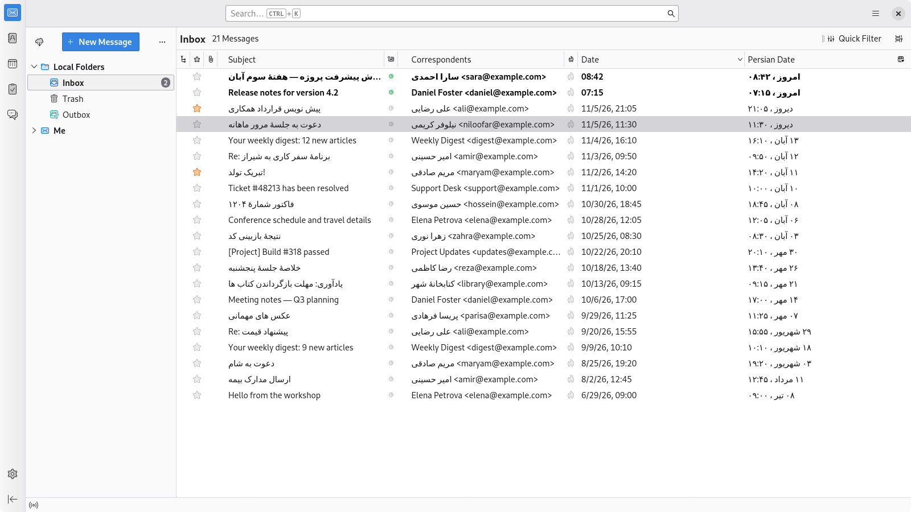
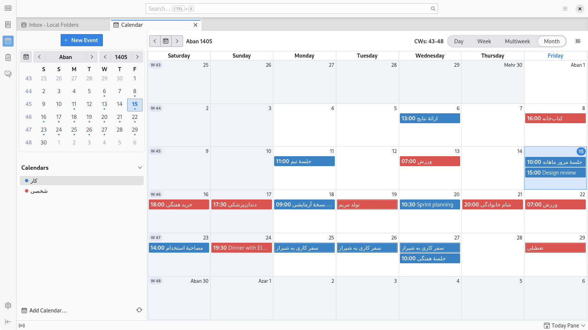
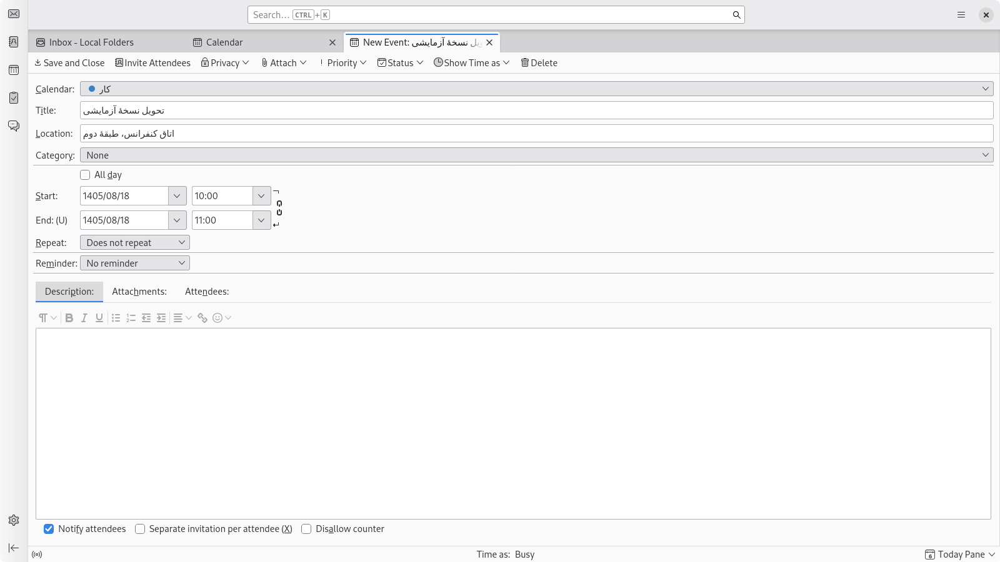
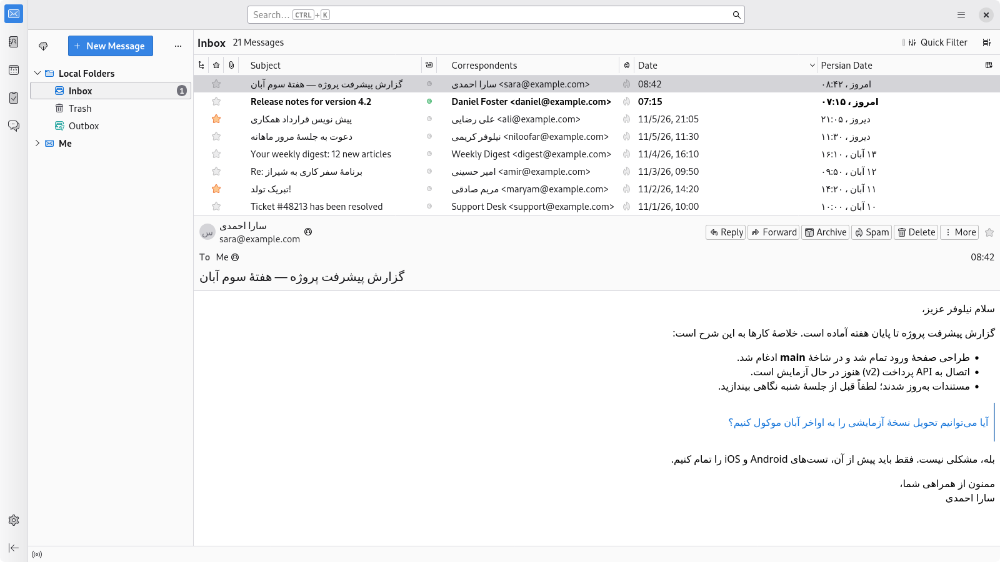
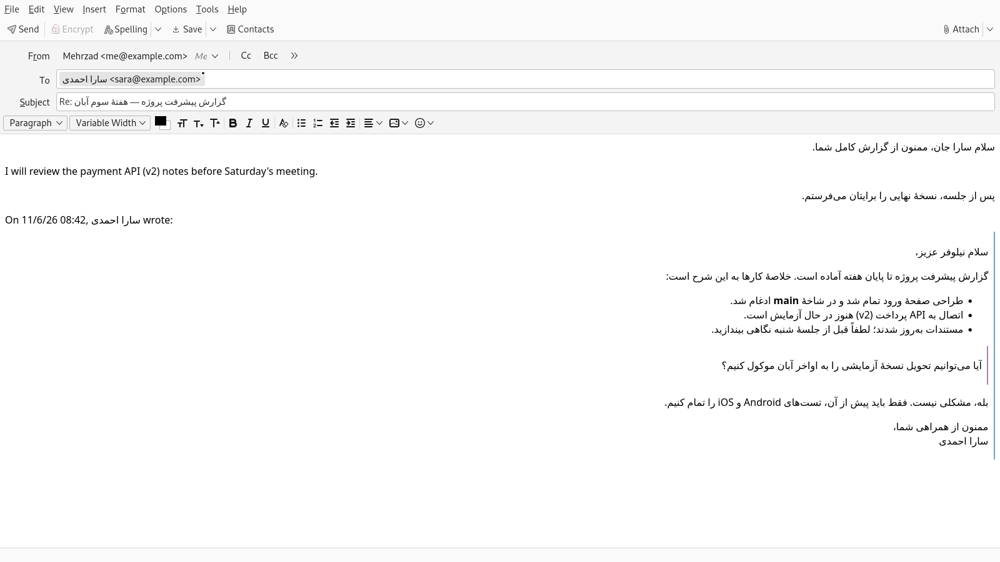
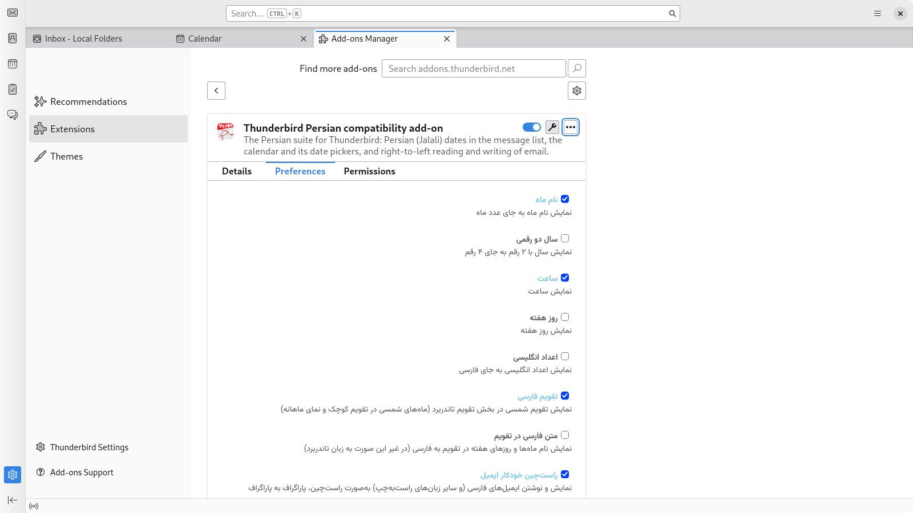

# Persian Compatibility for Thunderbird

[فارسی](README.fa.md)

This add-on makes Thunderbird work the way a Persian reader and writer expects:

| Feature | What you get |
| --- | --- |
| **Message list** | A *Persian Date* column with Jalali (Shamsi) dates that sorts correctly. |
| **Calendar** | Persian months in the calendar tab and the mini-month, Jalali titles and day labels, leap-year Esfand, Persian month navigation. |
| **Date pickers** | Event and task dialogs, the recurrence preview and the print range pickers use Persian dates (`1405/01/15`). |
| **Reading mail** | Persian (and other right-to-left) messages are laid out right-to-left, paragraph by paragraph, in HTML and plain text. |
| **Writing mail** | The compose window sets the direction of each paragraph as you type, so the sent message reads correctly everywhere. |

Everything can be switched on or off separately in the add-on's options.

## Requirements

Thunderbird **159** (tested on 159.0 and 160.0b5). The add-on uses Thunderbird's experiment APIs, so it is installed
from an XPI file (see below).

When you install it, Thunderbird will ask for permission to *read and modify messages as they are displayed* and to
*access the compose window*: those are what the right-to-left support runs on.

## Install

1. Download the XPI from the
   [releases](https://github.com/MehrzadGolabi/persian-compatibility-for-thunderbird/releases/) page, or build it yourself:

   ```sh
   cd src && zip -r ../persian-compatibility-for-thunderbird.xpi .
   ```

2. In Thunderbird open **Tools > Add-ons and Themes**, click the gear and choose **Install Add-on From File...**
   (do not use *Debug Add-ons > Load Temporary Add-on* for everyday use: temporary add-ons disappear on restart).

## Using it

### Message list

A **Persian Date** column is added to the message list. Use the column picker at the right end of the header to
hide or show it. Today's and yesterday's messages are labelled *Today* and *Yesterday* (امروز and دیروز), and sorting
by the column sorts by the real date.



### Calendar

Open the calendar tab: the mini-month and the month view show Persian months, with Persian month titles, day labels
and navigation. Events and tasks are stored as usual and appear on the right Persian day. For the best result set
**Saturday** as the first day of the week (and Friday as a day off) in *Settings > Calendar > General*. The add-on
does not change your preferences.



### Date pickers

The date fields in the event and task dialogs, the attendees and reminder dialogs, the recurrence "until" field and
the date range of the calendar's print dialog (list layout) show Persian dates as `yyyy/mm/dd`. You can type Persian
or Latin digits, `d/m/yyyy` also works, and a Gregorian date you paste (`2026-04-01`) is converted. The popup next to
a field is the Persian mini-month, and the recurrence dialog's preview steps through Persian months.



### Reading mail

Thunderbird shows a message left-to-right unless the message says otherwise, which leaves Persian paragraphs
left-aligned, bullets and quote bars on the wrong side, and mixed Persian/English lines in the wrong order.
Messages that contain right-to-left text get the right direction per paragraph, list and quote (HTML), or per line
(plain text). English messages are not touched, and a direction chosen by the author of a message is always
respected.



### Writing mail

Each paragraph in the compose window takes the direction of its first strong character as you type, also in the
quoted part of a reply, and that direction is part of the message you send. If you set a direction yourself with
Thunderbird's own direction buttons, the add-on keeps it.

With Thunderbird's default send format ("Automatic") a simple HTML message is sent as plain text, which would drop
the direction; so when a message carries a right-to-left direction, the add-on sends it as HTML plus text instead
(what Automatic already does for formatted mail). If you chose a send format yourself, that choice is kept.
Plain-text messages cannot carry a direction, so there the compose window just shows each line the way it reads.



### Options

Open **Tools > Add-ons and Themes**, find the add-on and choose **Preferences**. You can choose the month style (name
or number), a two-digit year, the time, the weekday and Persian or Latin digits for the message list column, show
Persian month and weekday names in the calendar even when Thunderbird itself is in another language, and switch the
calendar and the right-to-left support on or off. The options page itself is in Persian.



## Limitations

* Week numbers stay ISO weeks.
* Recurrence **rules** are Gregorian: iCalendar cannot express "every 1 Farvardin", so repeating events follow the
  Gregorian calendar. (The recurrence dialog's preview does show the occurrences on Persian months, but its rule
  options, such as "every year on March 21", still name Gregorian months.)
* The print dialog's month-grid and week-planner layouts print Gregorian pages, so their own month and year
  controls stay Gregorian. Printed date text (list layout) is Persian.
* The header area and message list of Thunderbird itself keep Thunderbird's own direction.

## Development

See [DEVELOPMENT.md](DEVELOPMENT.md).

## Credits

This project is a fork of [Mahoor](https://github.com/mhdzli/mahoor) by M.Zeinali. The API-Extension source is based
on [Full address column](https://addons.thunderbird.net/en-US/thunderbird/addon/full-address-column/?src=ss)
([GitHub Page](https://github.com/lkosson/full-address-column)) by Łukasz Kosson. The Vazirmatn font in the options
page is by Saber Rastikerdar.
